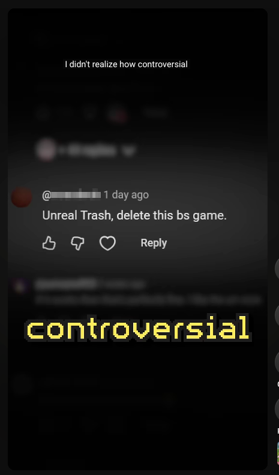
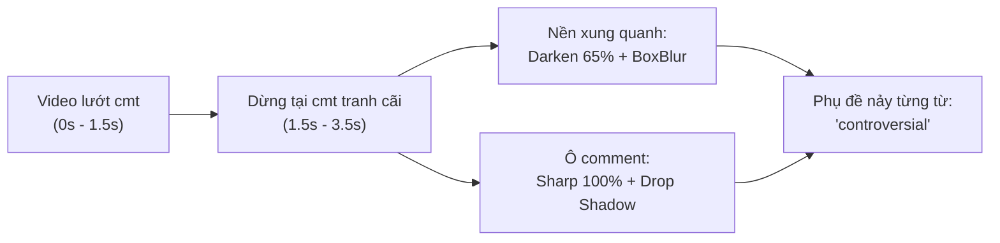
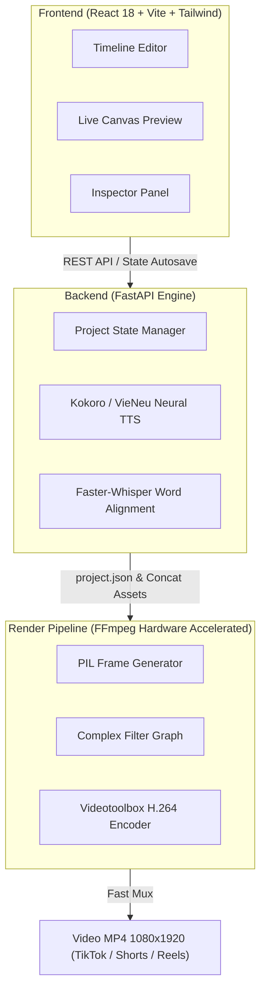

<div align="center">

# 🎬 ShortVideo Studio (APPAI)
### **Local AI Studio for Shorts, Reels & TikTok: Devlog Storytelling, Neural Voice & Kinetic Subtitles**

*Tự động hóa sản xuất video ngắn chuẩn phong cách Devlog Storytelling 100% Local trên máy (Apple Silicon M-Series / GPU) — 0 đồng chi phí API, bảo mật tuyệt đối, render 3–5 giây.*

<p align="center">
  
  
  
  
  
  
</p>

[✨ Tính năng nổi bật](#-tính-năng-nổi-bật) • [🚀 Khởi động nhanh](#-khởi-động-nhanh) • [🎯 Kỹ thuật Spotlight Focus](#-kỹ-thuật-spotlight-focus-comment-callout) • [🏗️ Kiến trúc hệ thống](#-kiến-trúc-hệ-thống) • [📖 Tài liệu chi tiết](#-tài-liệu-tham-khảo)

<br/>

<table align="center">
  <tr>
    <td align="center" width="50%">
      <b>🎨 Giao diện Timeline Shorts Studio (React + FastAPI)</b><br/><br/>
      
    </td>
    <td align="center" width="50%">
      <b>🎯 Hiệu ứng Spotlight Focus & Subtitle nảy từng từ</b><br/><br/>
      
    </td>
  </tr>
</table>

</div>

---

## 🌟 Điểm nổi bật & Triết lý thiết kế

Khác với các ứng dụng đám mây đắt đỏ (CapCut Pro, ElevenLabs tính phí theo từng ký tự) hoặc các công cụ tự động nuốt chữ, **ShortVideo Studio** được thiết kế chạy trực tiếp trên phần cứng máy tính:

1. **🎙️ Neural TTS Local (0đ API, biểu cảm tự nhiên):**
   - **Tiếng Anh (Kokoro ONNX):** Tốc độ <0.3s/câu, preset độc quyền `blend_young_devlog` và `am_adam` được cân bằng âm trầm (EQ 75Hz cut, bass +2dB) chuẩn chất giọng ấm của các kênh Devlog đình đám.
   - **Tiếng Việt (VieNeu):** Hỗ trợ zero-shot clone giọng từ mẫu audio 3–8 giây.
2. **⚡ Bắt mốc từng từ (Word-level Kinetic Subtitles):**
   - Whisper trích xuất timestamp chính xác tới từng từ.
   - Chữ nảy động (1–2 từ/burst) với font dày bản (Impact / Arial Black / Pixel font), viền đen tương phản, tự động đổi màu từ khóa quan trọng.
   - Không phụ thuộc vào `libass` (tránh lỗi font/thiếu thư viện trên macOS).
3. **🎯 Hiệu ứng Spotlight Focus & Comment Callout:**
   - Kỹ thuật mở đầu video ngắn kinh điển: Video lướt bình luận $\rightarrow$ nền xung quanh lập tức **tối sầm (Dim 65%)** và **làm mờ (Blur)** $\rightarrow$ ô bình luận tranh cãi được **nổi bật sắc nét ở trung tâm** kèm đổ bóng nổi bật.
4. **🎬 Timeline Đa Track & Xếp B-Roll tự động:**
   - Track 1: Video nền (b-roll, gameplay, contain blur 9:16).
   - Track 2: Lớp phủ (Icon, sticker, ảnh meme, ảnh comment).
   - Track 3: Chữ phụ đề nảy động.
   - Track 4: Giọng đọc và sóng âm.
   - Thuật toán **"⚡ Tự xếp theo câu"** tự động chia đều b-roll theo nhịp ngắt câu.
5. **🚀 Tốc độ Render thần tốc (Hardware Acceleration):**
   - Tận dụng bộ tăng tốc phần cứng Apple Silicon GPU (Videotoolbox H.264) xuất video Full HD 1080×1920 60FPS chỉ mất **3 – 5 giây**.

---

## 🚀 Khởi động nhanh

### 1. Yêu cầu hệ thống
- macOS (tối ưu nhất cho chip M1/M2/M3/M4) hoặc Linux / Windows.
- [FFmpeg](https://ffmpeg.org/) đã được cài đặt (`brew install ffmpeg`).
- Python 3.10+ & Node.js 18+.

### 2. Cài đặt môi trường
```bash
# Clone repository
git clone https://github.com/tuandat1601/ShortVideo.git
cd ShortVideo

# Tạo môi trường ảo Python
python3 -m venv .venv
source .venv/bin/activate
pip install -r studio/requirements.txt  # hoặc cài dependencies
```

### 3. Khởi động Shorts Studio (Mới)
```bash
./studio/run.sh
```
Mở trình duyệt tại: **`http://127.0.0.1:8765`** để bắt đầu sáng tạo video!

---

## 🎯 Kỹ thuật Spotlight Focus (Comment Callout)



Để áp dụng hiệu ứng trong hình demo:
1. Nạp video lướt bình luận vào tab **Media** $\rightarrow$ bấm **`+ Nền`**.
2. Nạp ảnh chụp riêng ô bình luận $\rightarrow$ bấm **`+ Lớp phủ`**.
3. Chọn clip Lớp phủ trên Timeline $\rightarrow$ tại bảng Inspector bên phải, tích chọn:  
   **`🎯 Làm tối mờ nền phía sau (Spotlight Focus)`**.
4. Xuất video MP4: Hệ thống tự động biên dịch sang filter graph FFmpeg `drawbox=color=black@0.65` và mux audio hoàn chỉnh.

---

## 🏗️ Kiến trúc hệ thống



---

## 📁 Cấu trúc dự án

```text
ShortVideo/
├── studio/                     # Shorts Studio (React + FastAPI + FFmpeg)
│   ├── api/                    # FastAPI endpoints & static file server
│   ├── assets/stickers/        # Icon, sticker mẫu (comment_box, arrow, badge)
│   ├── core/                   # Project models (project.py, word, clip)
│   ├── engines/                # Neural TTS (Kokoro ONNX, VieNeu) & Alignment
│   ├── render/                 # Compiler FFmpeg & Pillow Subtitle Generator
│   ├── web/                    # Giao diện React + TypeScript + Vite
│   └── run.sh                  # Script khởi động 1-click
├── long-tieng/                 # Studio Lồng tiếng 7 Cửa (Gradio wizard)
├── docs/                       # Toàn bộ tài liệu chi tiết
│   ├── HUONG_DAN_SU_DUNG.md    # Hướng dẫn sử dụng chi tiết A - Z
│   ├── ARCHITECTURE.md         # Bản đồ tính năng & kiến trúc
│   ├── KIEN_TRUC_VA_PHONG_VAN.md# Bí kíp kỹ thuật & Playbook phỏng vấn
│   └── assets/                 # Ảnh minh họa và tư liệu
└── README.md
```

---

## 📖 Tài liệu tham khảo

- [Cẩm nang sử dụng Studio từ A – Z](docs/HUONG_DAN_SU_DUNG.md)
- [Bản đồ Kiến trúc hệ thống & Tech Stack](docs/ARCHITECTURE.md)
- [Tài liệu Kỹ thuật DSP, Voice Cloning & Playbook Phỏng vấn](docs/KIEN_TRUC_VA_PHONG_VAN.md)

---

<div align="center">
  <b>Developed with ❤️ for Indie Game Devs, Creators & Storytellers</b>
</div>
