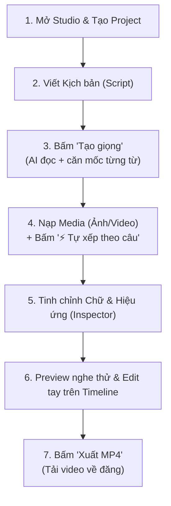

# HƯỚNG DẪN SỬ DỤNG APPAI STUDIO TỪ A – Z
> **Cẩm nang làm video ngắn (Shorts / Reels / TikTok) và Lồng tiếng chuyên nghiệp**  
> Chạy 100% Local trên máy (Mac M4), không tốn chi phí API, chuẩn phong cách Devlog Storytelling.

---

## MỤC LỤC
1. [Tổng quan: Hai công cụ trong APPAI](#1-tổng-quan-hai-công-cụ-trong-appai)
2. [Quy trình làm một video Shorts từ A – Z (Shorts Studio)](#2-quy-trình-làm-một-video-shorts-từ-a--z)
3. [Giải thích chi tiết tất cả các chức năng trên giao diện](#3-giải-thích-chi-tiết-các-chức-năng)
4. [Mẹo chỉnh hiệu ứng tay & Tùy biến nâng cao](#4-mẹo-chỉnh-hiệu-ứng-tay--tùy-biến-nâng-cao)
5. [Hướng dẫn tự động hóa bằng lệnh CLI (Tiết kiệm token cho AI)](#5-hướng-dẫn-dùng-lệnh-cli)
6. [Quy trình lồng tiếng video có sẵn (Gradio 7 Cửa)](#6-quy-trình-lồng-tiếng-video-có-sẵn)

---

## 1. TỔNG QUAN HAI CÔNG CỤ TRONG APPAI

Trong dự án **APPAI** hiện có 2 công cụ phục vụ 2 mục đích làm video khác nhau:

| Công cụ | Công nghệ | Mục đích sử dụng chính | Cách khởi động |
|---|---|---|---|
| **Shorts Studio (Mới)** | React + FastAPI + FFmpeg | **Làm video từ kịch bản:** Viết text $\rightarrow$ sinh giọng đọc cảm xúc $\rightarrow$ chữ nảy 1–2 từ/lần $\rightarrow$ ghép ảnh/clip b-roll theo nhịp câu. | Chạy lệnh: `/Users/tuandat/Documents/projects/APPAI/studio/run.sh`<br>Mở: `http://127.0.0.1:8765` |
| **Lồng tiếng 7 Cửa (Cũ)** | Gradio + Python | **Lồng tiếng video có sẵn:** Nhập 1 file video nước ngoài $\rightarrow$ bóc sub $\rightarrow$ dịch tiếng Việt $\rightarrow$ clone giọng đè lên video gốc. | Chạy lệnh: `cd long-tieng && source .venv/bin/activate && python app.py`<br>Mở: `http://127.0.0.1:7860` |

---

## 2. QUY TRÌNH LÀM MỘT VIDEO SHORTS TỪ A – Z

*(Theo đúng phong cách video mẫu indie dev: giọng trầm ấm, chữ nảy giữa màn hình, cắt cảnh 1–3s liên tục)*



### Bước 1: Khởi động Studio
Mở Terminal và gõ:
```bash
/Users/tuandat/Documents/projects/APPAI/studio/run.sh
```
Trình duyệt sẽ mở giao diện tại: **http://127.0.0.1:8765** (hoặc `http://localhost:5173`).  
Bấm nút **`+ Mới`** trên thanh tiêu đề và nhập tên dự án (ví dụ: *Devlog Tap 1*).

---

### Bước 2: Viết kịch bản (Script)
- Ở cột trái, chọn tab **"Script & giọng"**.
- Nhập kịch bản tiếng Anh của bạn vào ô văn bản.  
  *Mẹo viết:* Hãy ngắt câu bằng dấu chấm rõ ràng. Mỗi câu nên ngắn gọn từ 6 đến 15 từ để AI ngắt nhịp thở tự nhiên.
  > *Ví dụ:*  
  > `I spent three months building my first game.`  
  > `Everyone told me Unreal Engine was too heavy.`  
  > `If you turn off Nanite and Lumen, it runs super smooth.`

---

### Bước 3: Chọn giọng & Bấm "Tạo giọng"
1. **Giọng:** Chọn một trong các chất giọng được thiết kế sẵn:
   - `【EN Devlog Trẻ / Độc quyền】blend_young_devlog`: **Khuyên dùng!** Giọng nam trẻ trung (20–25t), ấm áp, không trùng với ai.
   - `【EN Devlog / Trầm ấm】am_adam`: Giọng nam trầm, kể chuyện điềm đạm.
   - `kimbo3d_younger`: Giọng clone từ chính kênh YouTube mẫu nhưng đã được nâng tông trẻ hơn.
2. **Phong cách:** Chọn **`Devlog / Chill`** (đã tích hợp sẵn EQ tăng âm trầm, làm ấm giọng như mic Shure SM7B).
3. **Tốc độ:** Giữ `1.00×` hoặc chỉnh `0.95×` cho chậm rãi, thư thái.
4. Bấm nút màu tím: **`Tạo giọng`**.  
   *Hệ thống sẽ chạy ngầm:* Sinh giọng $\rightarrow$ áp filter phòng thu $\rightarrow$ Whisper tự động bắt mốc thời gian của từng từ $\rightarrow$ Timeline bên dưới sẽ lập tức hiện dải sóng âm màu xanh và các hộp chữ từng từ.

---

### Bước 4: Nạp Media & Bấm "⚡ Tự xếp theo câu"
1. Chuyển sang tab **"Media"** ở cột trái.
2. Bấm nút **`+ Thêm ảnh / video`** và chọn các ảnh chụp màn hình game, clip gameplay, ảnh meme mèo, ảnh comment...
3. Bấm nút ma thuật: **`⚡ Tự xếp theo câu`**.  
   *Tác dụng:* Tool sẽ tự động tính toán thời lượng của từng câu nói và rải đều các clip/ảnh lên track video trên timeline. Bạn không cần phải kéo thả thủ công từng file!

---

### Bước 5: Chỉnh kiểu chữ & Khung hình (Bảng Inspector bên phải)
Ở cột phải, bạn có thể chỉnh thẩm mỹ cho chữ:
- **Font:** Chọn `Impact` (font chữ to bản, dày dặn kinh điển của video ngắn) hoặc `Arial Black`.
- **Cỡ chữ:** Kéo khoảng `110px – 130px`.
- **Viền:** Để `10px – 14px` màu đen (giúp chữ luôn nổi trên nền sáng).
- **Vị trí dọc:** Mặc định `55%` (ngay giữa màn hình).
- **Số từ hiện cùng lúc:** Bấm chọn `2` (hiển thị từng cụm 2 từ một như video mẫu).
- **Màu từ khóa:** Mặc định là màu xanh Cyan neon `#2EE6FF`.

---

### Bước 6: Nghe thử trên Preview & Chỉnh tay (Timeline)
- Bấm phím **`Space`** (Phím cách) để phát / tạm dừng.
- Quan sát video chạy ở khung dọc 9:16: chữ chạy khớp từng từ với giọng nói.
- **Nếu muốn đổi màu chữ của một từ nào đó:** Chỉ cần dùng chuột **click thẳng vào từ đó trên track "CHỮ"** ở timeline. Từ đó sẽ đổi màu nổi bật ngay lập tức.
- **Nếu muốn clip kéo dài hơn hoặc ngắn lại:** Rê chuột vào mép phải của clip tím trên timeline và kéo để co giãn.

---

### Bước 7: Xuất video thành phẩm (Xuất MP4)
- Bấm nút **`Xuất MP4`** màu hồng cánh sen ở góc trên bên phải.
- Hệ thống sẽ render bằng phần cứng Apple Silicon GPU (Videotoolbox) chỉ mất khoảng **3 – 5 giây**.
- Khi xong, màn hình hiện link **"Mở video"**. Bạn bấm vào để tải file `.mp4` 1080×1920 sắc nét về đăng lên YouTube Shorts, TikTok, Facebook Reels!

---

## 3. GIẢI THÍCH CHI TIẾT CÁC CHỨC NĂNG

### A. Thanh tiêu đề (Top Bar)
- **Menu chọn Project:** Chuyển đổi qua lại giữa các dự án video bạn đã tạo.
- **Nút `+ Mới`:** Tạo một video mới toanh.
- **Nút Undo `↶` (⌘Z) / Redo `↷` (⇧⌘Z):** Khôi phục thao tác vừa chỉnh nếu lỡ tay làm sai.
- **Trạng thái lưu:** Tự động lưu mọi thay đổi sau 0.6 giây (Autosave).
- **Nút `Xuất MP4`:** Render toàn bộ timeline ra file video cuối cùng.

### B. Cột trái (Sidebar)
#### Tab "Script & giọng":
- **Ô Text Kịch bản:** Nơi gõ lời thoại. Hỗ trợ câu ngắn, ngắt dòng.
- **Dropdown Giọng:** Chọn giọng nam/nữ, giọng Anh-Mỹ (`am_`), Anh-Anh (`bm_`) hoặc giọng blend độc quyền.
- **Dropdown Phong cách:**
  - *Devlog / Chill:* Tăng bass ấm, dịu treble, nén âm chống rè.
  - *Kể chuyện:* Chậm ấm, tự sự.
  - *Năng lượng:* Nhanh, vang nhẹ, hào hứng.
  - *Bình thường:* Âm thanh gốc không can thiệp filter.
- **Thanh trượt Tốc độ:** Điều chỉnh từ `0.70×` (rất chậm) đến `1.30×` (nhanh).

#### Tab "Media":
- **Nút `+ Thêm ảnh / video`:** Upload các tài nguyên hình ảnh, clip từ máy tính vào project.
- **Nút `⚡ Tự xếp theo câu`:** Thuật toán AI tự khớp từng ảnh/video vào mốc thời gian bắt đầu và kết thúc của từng câu thoại.
- **Lưới thumbnails:** Click vào ảnh/clip để chèn thêm vào cuối timeline.

### C. Khung Preview (Màn hình chính giữa)
- **Tỉ lệ 9:16 chuẩn Shorts:** Khung viền bo tròn, hiển thị chính xác những gì sẽ xuất hiện trên màn hình điện thoại.
- **Nút điều khiển:** `⏮` Về đầu, `▶ / ❚❚` Phát / Dừng, đồng hồ đếm thời gian chính xác đến `0.1s`.

### D. Cột phải (Inspector - Bảng thuộc tính)
*Khi không chọn clip nào:* Bảng sẽ điều khiển **CHỮ (CAPTION)**:
- **Font & Size:** Kiểu chữ và độ to nhỏ.
- **Viền (Stroke):** Độ dày nét đen bao quanh chữ.
- **Vị trí dọc (Y %):** Đẩy chữ lên cao hoặc hạ thấp xuống để tránh bị che bởi nút like/comment của TikTok/YouTube.
- **Số từ hiện cùng lúc (Max words):** 1 từ (nhanh, giật gân), 2 từ (chuẩn devlog), 3–4 từ (đọc chậm).
- **Bộ 3 ô màu:** Màu chữ thường (trắng), Màu từ khóa nổi bật (cyan/vàng), Màu viền chữ (đen).
- **Màu nền video:** Màu nền dự phòng khi không có clip phủ (mặc định đen tím tối `#0B0B12`).

*Khi click chọn 1 Clip trên timeline:* Bảng sẽ đổi sang **CLIP ĐANG CHỌN**:
- **Bắt đầu (Start) & Độ dài (Dur):** Vị trí và thời gian phát của clip.
- **Cắt từ giây (In point):** Chỉ lấy một đoạn hay nhất trong clip dài (ví dụ video dài 1 phút, bạn nhập `15.0` thì nó sẽ phát từ giây 15).
- **Khung hình (Fit):**
  - *Phủ kín (Cover):* Phóng to video cho vừa khít màn hình dọc (cắt bớt 2 bên mép).
  - *Giữ nguyên + nền mờ (Contain blur):* Giữ nguyên tỷ lệ gốc của video ngang, nền phía sau tự động làm mờ nhòe cực đẹp.
- **Nút Xóa clip:** Bỏ clip khỏi timeline.
- **✨ Hiệu ứng (Effects / Animation):**
  - *🎯 Tiêu điểm cmt / Spotlight:* Làm tối và mờ toàn bộ nền xung quanh (~65% black mask), giữ overlay (ảnh bình luận/sticker) sáng rõ nét căng ở trung tâm (kèm đổ bóng nổi bật).
  - *🌫️ Mờ & Tối nền (Dim & Blur):* Làm mờ (`boxblur`) và hạ độ sáng nền video khi muốn khán giả tập trung vào chữ hoặc lớp phủ.
  - *🔍 Zoom vào chậm (Ken Burns) / 🔎 Zoom ra chậm:* Tạo chuyển động nhẹ cho ảnh tĩnh.
  - *⚡ Flash / 🌫️ Fade in:* Chớp sáng trắng hoặc mờ dần khi chuyển cảnh.
- **🎯 Làm tối mờ nền phía sau (Spotlight Focus):** Tùy chọn 1-click cho Track Overlay giúp tự động tạo lớp màn đen mờ phía sau icon / screenshot comment.

### E. Dưới cùng (Timeline đa track)
- **Track 1: Video / Ảnh:** Chứa các khối màu tím. Bạn có thể kéo khối để di chuyển thời gian, hoặc kéo mép phải để co giãn độ dài.
- **Track 2: Chữ:** Hiển thị từng từ mà AI đã bóc tách. Khối màu xanh cyan là từ khóa nổi bật, màu xám là từ thường. Click để đổi trạng thái.
- **Track 3: Giọng:** Sóng âm thanh màu xanh lá cây đại diện cho file giọng đọc.
- **Con trỏ đỏ (Playhead):** Hiển thị thời gian hiện tại. Bấm vào bất kỳ đâu trên thước đo thời gian để nhảy tới giây đó.

---

## 4. MẸO CHỈNH HIỆU ỨNG TAY & TÙY BIẾN NÂNG CAO

1. **Bắt dính thông minh (Smart Snapping):**  
   Khi bạn kéo một clip trên timeline, nó sẽ tự động "hút" (snap) vào điểm kết thúc của câu thoại gần nhất. Nhờ đó bạn không bao giờ sợ bị lệch hình so với tiếng.
2. **Nhấn mạnh từ khóa:**  
   Trong kịch bản, các từ như *Unreal, Nanite, Sixty FPS, Trash, Heavy* nên được click chuyển sang màu xanh Cyan để người xem lướt feed sẽ bị cuốn mắt vào màn hình ngay lập tức.
3. **Phím tắt cần nhớ:**
   - `Space`: Bật / Tắt preview.
   - `Delete` hoặc `Backspace`: Xóa clip đang chọn trên timeline.
   - `⌘ + Z` (Mac): Hoàn tác bước trước đó.
   - `Shift + ⌘ + Z`: Làm lại thao tác vừa hoàn tác.

---

## 5. HƯỚNG DẪN DÙNG LỆNH CLI (TIẾT KIỆM TOKEN CHO AI)

Nếu bạn muốn nhờ AI Agent làm hộ video mà không muốn tốn token chat, chỉ cần chuẩn bị sẵn file script và chạy qua CLI nội bộ của Studio:

```bash
# 1. Kích hoạt môi trường
source /Users/tuandat/Documents/projects/APPAI/long-tieng/.venv/bin/activate

# 2. Tạo dự án mới
python -m studio.cli.studio new "My_Game_Devlog"

# 3. Gán kịch bản
python -m studio.cli.studio script <PROJECT_ID> "Your script text here..."

# 4. Sinh giọng & căn mốc từng từ
python -m studio.cli.studio voice <PROJECT_ID> --voice "【EN Devlog Trẻ / Độc quyền】blend_young_devlog" --style "Devlog / Chill"

# 5. Nạp media & tự động xếp b-roll
python -m studio.cli.studio add-media <PROJECT_ID> /duong/dan/anh1.png
python -m studio.cli.studio add-media <PROJECT_ID> /duong/dan/video2.mp4
python -m studio.cli.studio auto-broll <PROJECT_ID>

# 6. Xuất video MP4
python -m studio.cli.studio render <PROJECT_ID>
```
File hoàn chỉnh sẽ nằm ngay tại thư mục:  
`APPAI/studio/projects/<PROJECT_ID>/out/My_Game_Devlog.mp4`.

---

## 6. QUY TRÌNH LỒNG TIẾNG VIDEO CÓ SẴN (GRADIO 7 CỬA)

Nếu bạn có **một video nước ngoài đầy đủ** và muốn dịch sang tiếng Việt để lồng tiếng lại:

1. Khởi động bản cũ:
   ```bash
   cd /Users/tuandat/Documents/projects/APPAI/long-tieng
   source .venv/bin/activate
   python app.py
   ```
2. Truy cập: **http://127.0.0.1:7860**
3. Đi theo đúng **7 Cửa tuần tự**:
   - **Cửa 1 (Nhập video):** Tải video mp4 gốc lên $\rightarrow$ Tách tiếng.
   - **Cửa 2 (Sub gốc):** Whisper tự bóc phụ đề tiếng Anh gốc (`orig.srt`).
   - **Cửa 3 (Dịch):** Dịch sang tiếng Việt bằng Gemini/OpenAI hoặc dán bản dịch từ ChatGPT vào.
   - **Cửa 4 (Khóa bản đọc):** Duyệt lại câu từ tiếng Việt $\rightarrow$ Bấm **Khóa bản đọc**.
   - **Cửa 5 (Nhét giọng):** Chọn giọng tiếng Việt (`VieNeu`) hoặc thu âm giọng mình qua mic $\rightarrow$ AI đọc từng câu và co giãn khớp mốc giờ gốc.
   - **Cửa 6 (Căn vị trí sub):** Kéo thả ô viền xanh trên khung xem trước để đặt vị trí phụ đề.
   - **Cửa 7 (Xuất mp4):** Đốt phụ đề và mux giọng mới vào video gốc.

---

## CHANGELOG
- 2026-11-05: Bổ sung hiệu ứng **Spotlight Focus** (Tối mờ nền để làm nổi bật comment/icon callout) và **Dim & Blur background** cho cả preview web lẫn render FFmpeg hardware acceleration.

---
*Tài liệu này luôn nằm tại [`APPAI/docs/HUONG_DAN_SU_DUNG.md`](file:///Users/tuandat/Documents/projects/APPAI/docs/HUONG_DAN_SU_DUNG.md) để bạn tra cứu bất kỳ lúc nào!*
