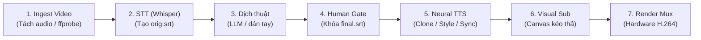

# TÀI LIỆU TOÀN DIỆN: KIẾN TRÚC HỆ THỐNG, CÔNG NGHỆ & BÍ KÍP PHỎNG VẤN (APPAI STUDIO)

> Tài liệu này được thiết kế như một **Playbook phỏng vấn chuyên sâu** (dành cho Software Engineer, AI Engineer, Fullstack) khi bạn giới thiệu dự án **APPAI (Studio Lồng tiếng & Phụ đề Local)**.

---

## MỤC LỤC
1. [Tổng quan dự án & Bài toán giải quyết (Elevator Pitch)](#1-tổng-quan-dự-án--bài-toán-giải-quyết)
2. [Triết lý thiết kế & Kiến trúc 7 Cửa (Gated Pipeline Architecture)](#2-triết-lý-thiết-kế--kiến-trúc-7-cửa)
3. [Bản đồ Tech Stack & Lý do lựa chọn công nghệ](#3-bản-đồ-tech-stack--lý-do-lựa-chọn)
4. [Bản chất công nghệ AI: Speech-to-Text & Text-to-Speech](#4-bản-chất-công-nghệ-ai-stt--tts)
5. [Cơ chế Voice Cloning: Từ giọng mình sang giọng người khác](#5-cơ-chế-voice-cloning-chi-tiết)
6. [Kỹ thuật Audio DSP & Đồng bộ thời gian (Audio Synchronization)](#6-kỹ-thuật-audio-dsp--đồng-bộ-thời-gian)
7. [Giải pháp Burn Sub độc đáo: Vượt qua hạn chế thiếu libass](#7-giải-pháp-burn-sub-độc-đáo-không-cần-libass)
8. [Tối ưu hóa phần cứng trên Apple Silicon (Mac M4)](#8-tối-ưu-hóa-phần-cứng-trên-mac-m4)
9. [Bộ câu hỏi phỏng vấn hóc búa & Cách trả lời ghi điểm (Q&A)](#9-bộ-câu-hỏi-phỏng-vấn-hóc-búa--cách-trả-lời)

---

## 1. TỔNG QUAN DỰ ÁN & BÀI TOÁN GIẢI QUYẾT

### 1.1. Elevator Pitch (Câu mở đầu 30 giây khi phỏng vấn)
> *"Em xây dựng APPAI – một **Local AI Dubbing Studio**, giải quyết bài toán chuyển ngữ và lồng tiếng video hoàn chỉnh để đăng lên YouTube/TikTok. Thay vì phụ thuộc vào các dịch vụ cloud đắt đỏ như ElevenLabs hay CapCut Pro, toàn bộ pipeline từ **tách phụ đề (STT)**, **sinh giọng đọc cảm xúc / clone giọng (TTS)** và **đốt phụ đề mux video (FFmpeg)** đều chạy 100% cục bộ trên phần cứng của máy. Hệ thống được kiến trúc theo mô hình **7-Gate Pipeline (State Machine)** đảm bảo độ chính xác theo từng cue thời gian mà không bao giờ bị nuốt chữ hay lệch khẩu hình."*

### 1.2. Pain points mà dự án giải quyết
1. **Chi phí API khủng khiếp:** Các dịch vụ TTS như ElevenLabs tính tiền theo từng ký tự (\$0.30 - \$1.00 / 1000 ký tự). Một video 10 phút có thể tốn vài chục nghìn đến cả trăm nghìn đồng. APPAI đưa chi phí TTS về **0 đồng** nhờ mô hình Local.
2. **Quyền riêng tư & Bảo mật dữ liệu:** Video gốc và giọng mẫu cá nhân không bị tải lên bất kỳ máy chủ bên thứ ba nào.
3. **Lỗi đồng bộ thời gian (Sync Drift) ở các công cụ tự động:** Các app auto-dubbing trên thị trường thường đọc cả bài một mạch dẫn đến video chạy một đằng, tiếng đọc một nẻo. APPAI giải quyết bằng thuật toán **Cue-by-Cue Alignment**.

---

## 2. TRIẾT LÝ THIẾT KẾ & KIẾN TRÚC 7 CỬA



### Tại sao không làm một nút "One-Click Auto Dub"?
- **Nguyên lý thiết kế:** Trong quy trình xử lý media, **sai số tích lũy (error propagation)** là kẻ thù lớn nhất. Nếu bước nhận diện phụ đề (STT) nghe sai 1 từ, bước dịch sẽ dịch sai cả câu, bước TTS sẽ đọc câu vô nghĩa, và video xuất ra bị hỏng.
- **Giải pháp 7 Cửa:**
  - Mỗi cửa có đầu vào và đầu ra là file cụ thể (`source.mp4`, `orig.srt`, `target.srt`, `final.srt`, `voice_new.wav`, `subs/*.png`).
  - Cửa sau chỉ mở khi cửa trước hoàn thành và có sự kiểm duyệt của con người (**Human-in-the-Loop**).
  - Có cơ chế **Cache thông minh**: Nếu đổi tốc độ đọc hoặc đổi màu chữ, hệ thống tái sử dụng file TTS raw có sẵn, không chạy lại toàn bộ từ đầu.

---

## 3. BẢN ĐỒ TECH STACK & LÝ DO LỰA CHỌN

| Thành phần | Công nghệ sử dụng | Lý do kỹ thuật lựa chọn (Technical Justification) |
|---|---|---|
| **STT Engine** | `faster-whisper` (CTranslate2) | Chạy nhanh gấp 4 lần so với OpenAI Whisper gốc, tiêu tốn ít VRAM/RAM hơn nhờ lượng tử hoá int8/float16, hỗ trợ VAD (Voice Activity Detection) cắt khoảng lặng. |
| **TTS Tiếng Việt** | `VieNeu` | Mô hình TTS tiếng Việt hiện đại, hỗ trợ zero-shot clone từ file mẫu ngắn $\le 8$ giây. |
| **TTS Tiếng Anh** | `Kokoro ONNX` (StyleTTS2 Architecture) | Kích thước siêu nhẹ (~80M tham số, model ~300MB), tốc độ cực nhanh (<0.3s/câu trên Mac M4), biểu cảm tự nhiên chuẩn con người nhờ kiến trúc Style Diffusion. |
| **Media Processing** | `FFmpeg` + `ffprobe` | Công cụ xử lý audio/video tiêu chuẩn công nghiệp; dùng filter phức hợp (`atempo`, `highpass`, `treble`, `alimiter`, `concat`). |
| **Sub Rendering** | `Pillow` (PIL) | Sinh ảnh RGBA động theo toạ độ kéo thả của người dùng, giải quyết triệt để lỗi thiếu `libass` trên FFmpeg của macOS. |
| **UI Framework** | `Gradio 6` | Xây dựng giao diện web tương tác nhanh, hỗ trợ streaming logs, kéo thả audio/video và nhúng component JavaScript trực tiếp. |
| **Translation** | Hybrid (Gemini / OpenAI / Ollama Local) | Hỗ trợ BYOK (Bring Your Own Key) với cơ chế Fallback tự động khi gặp lỗi 429 Rate Limit. |

---

## 4. BẢN CHẤT CÔNG NGHỆ AI: STT & TTS

### 4.1. Speech-to-Text (STT) hoạt động như thế nào?
- **Whisper Architecture:** Mô hình **Transformer Encoder-Decoder** tiêu chuẩn:
  1. Âm thanh được cắt thành từng cửa sổ 30 giây và chuyển đổi thành **Log-Mel Spectrogram** (biểu diễn tần số theo thời gian).
  2. Encoder nén biểu phổ âm thanh thành các vector ngữ nghĩa.
  3. Decoder sinh ra chuỗi token từ ngữ theo thời gian thực kết hợp kỹ thuật **Cross-Attention**.
  4. Whisper xuất ra không chỉ văn bản mà còn **Timestamp mốc thời gian** của từng cụm từ dựa vào ma trận chú ý (Attention Matrix).

### 4.2. Text-to-Speech (TTS) hoạt động như thế nào?
Quy trình TTS thần kinh (Neural TTS) hiện đại gồm 2 giai đoạn:
1. **Giai đoạn 1: Acoustic Model (Mô hình âm học)**
   - Nhận vào: Chuỗi văn bản $\rightarrow$ qua bộ chuyển đổi âm vị **G2P (Grapheme-to-Phoneme)** để biến chữ viết thành ký hiệu phát âm quốc tế (IPA).
   - Dự đoán: Thời lượng từng âm vị (Duration Model), cao độ (Pitch), năng lượng (Energy) và sinh ra **Mel-Spectrogram** hoặc Latent Representation.
2. **Giai đoạn 2: Neural Vocoder (Bộ giải mã âm thanh)**
   - Nhận vào: Mel-Spectrogram từ giai đoạn 1.
   - Nhiệm vụ: Tái tạo lại sóng âm thanh dạng sóng thời gian thực (**Waveform WAV** 24kHz/48kHz).
   - Các kiến trúc phổ biến: HiFi-GAN, iSTFTNet, BigVGAN.

---

## 5. CƠ CHẾ VOICE CLONING CHI TIẾT

> *"Làm sao AI lấy 5 giây giọng của mình để nói lại câu hoàn toàn mới?"*

### 5.1. Khái niệm: Zero-Shot Voice Cloning
- Không cần phải fine-tune hay huấn luyện lại toàn bộ mô hình (mất hàng giờ).
- Chỉ cần một đoạn âm thanh ngắn (**Reference Audio** từ 3–10 giây).

### 5.2. Ba bước cốt lõi trong thuật toán Clone giọng:
1. **Trích xuất đặc trưng người nói (Speaker Embedding / Timbre Extraction):**
   - File thu âm của bạn được đưa qua một **Speaker Encoder** (như mô hình ECAPA-TDNN hoặc Style Diffusion Encoder).
   - Bộ mã hoá này trích xuất một vector cố định gọi là **Speaker Embedding** (ví dụ vector 256 chiều). Vector này đại diện cho âm sắc: độ dày, độ ấm, độ rung dây thanh quản của bạn.
2. **Kỹ thuật lọc năng lượng âm thanh (Energy Windowing):**
   - Trong code của APPAI (`_best_speech_window` trong `app.py`):
     ```python
     # Tính Root Mean Square (RMS) để tìm đoạn nói rõ nhất, bỏ đoạn thở dài hoặc im lặng
     e = float(np.sqrt(np.mean(np.square(chunk))))
     ```
   - Nhờ đó, dù file bạn tải lên có lẫn khoảng trống đầu/cuối, hệ thống vẫn tự động cắt lấy 8 giây "đẹp nhất".
3. **Điều kiện hoá mô hình sinh (Conditioned Generation):**
   - Khi mô hình Acoustic sinh giọng cho câu text mới, nó nhận **2 đầu vào**:
     $$\text{Audio Sinh} = \text{TTS}(\text{Text cần đọc}, \text{Speaker Embedding})$$
   - Mô hình áp vector đặc trưng của bạn vào nhịp phát âm của văn bản mới, sau đó Vocoder tổng hợp thành giọng nói của bạn.

---

## 6. KỸ THUẬT AUDIO DSP & ĐỒNG BỘ THỜI GIAN

Đây là **phần kỹ thuật ăn điểm nhất** khi phỏng vấn, chứng minh bạn không chỉ "gọi thư viện AI bừa bãi" mà thực sự hiểu sâu về xử lý tín hiệu số (Audio Engineering).

### 6.1. Bài toán: Lệch thời lượng giữa Video gốc và Câu TTS
- Giả sử câu gốc trong video dài **2.5 giây**.
- Khi AI đọc bản dịch tiếng Việt hoặc tiếng Anh, có thể mất **3.2 giây** (quá dài) hoặc chỉ **1.4 giây** (quá ngắn).

### 6.2. Thuật toán xử lý của APPAI:
1. **Nếu câu đọc ngắn hơn mốc:** Giữ nguyên tốc độ tự nhiên, chèn thêm khoảng lặng (Silence Padding) để câu tiếp theo rơi đúng timestamp.
2. **Nếu câu đọc dài hơn mốc:**
   - Dùng filter `atempo` của FFmpeg:
     ```bash
     ffmpeg -i input.wav -af "atempo=1.28" output.wav
     ```
   - **Điểm kỹ thuật quan trọng:** `atempo` sử dụng thuật toán **WSOLA (Waveform Similarity Overlap-Add)** giúp tăng tốc độ nói nhưng **giữ nguyên cao độ (pitch)** — giọng nói không bị biến thành "giọng sóc chuột Chipmunk".
   - **Giới hạn an toàn (Safe Boundary):** Nếu câu nói quá dài, hệ thống chỉ ép tốc độ tối đa lên $1.35\times$. Phần dôi dư sẽ được **tràn nhẹ (spillover ~0.3s)** sang khoảng nghỉ của câu sau, kiên quyết **không cắt cụt đuôi** (cắt cụt = nuốt chữ của người nói).

### 6.3. Chuỗi hiệu ứng âm thanh phòng thu (Audio DSP Chain):
Trong `dub.py`, preset `Devlog / Chill` biến mic rẻ tiền thành chất giọng ấm như podcast:
- `highpass=f=75`: Cắt bỏ toàn bộ tần số rác dưới 75Hz (tiếng ù quạt gió, rung bàn).
- `bass=g=2.0`: Tăng nhẹ dải trầm (proximity effect), tạo cảm giác giọng nói ấm áp ở ngực.
- `treble=g=0.5`: Cân bằng dải cao, làm mượt các âm gió xì (de-essing nhẹ).
- `alimiter=limit=0.95`: Bộ nén động lực học (dynamic limiter) ngăn hiện tượng vỡ tiếng (clipping) khi người nói đột ngột nói to.

---

## 7. GIẢI PHÁP BURN SUB ĐỘC ĐÁO: KHÔNG CẦN LIBASS

### 7.1. Bối cảnh sự cố kỹ thuật (Production Issue):
- Trên macOS, khi cài FFmpeg qua Homebrew (`brew install ffmpeg`), mặc định FFmpeg **không đi kèm thư viện `libass`** do vướng bản quyền hoặc thiếu cờ build.
- Lệnh tiêu chuẩn `ffmpeg -vf "subtitles=sub.srt"` sẽ lập tức văng lỗi: `No such filter: 'subtitles'`.

### 7.2. Giải pháp sáng tạo của APPAI:
Thay vì bắt người dùng phải tự biên dịch lại FFmpeg từ mã nguồn (rất phức tạp và dễ lỗi):
1. Dùng thư viện Python **`Pillow`** đọc từng dòng sub trong SRT.
2. Tạo các ảnh trong suốt định dạng **RGBA PNG** cho từng frame phụ đề, hỗ trợ tuỳ biến toạ độ $(X, Y)$, kích thước hộp chữ, màu viền và màu nền bán trong suốt.
3. Xuất file kịch bản `concat.txt` chứa mốc thời gian xuất hiện của từng ảnh PNG.
4. Dùng filter `overlay` native của FFmpeg để đè luồng ảnh lên video:
   ```bash
   ffmpeg -i source.mp4 -f concat -i subs/concat.txt -filter_complex "[0:v][1:v]overlay=x=0:y=0" ...
   ```
$\rightarrow$ **Kết quả:** Phụ đề hiển thị sắc nét từng pixel mà không cần bất kỳ dependency phức tạp nào từ bên ngoài.

---

## 8. TỐI ƯU HÓA PHẦN CỨNG TRÊN MAC M4

1. **Unified Memory Architecture (UMA):**
   - Mac M4 chia sẻ chung 16GB bộ nhớ giữa CPU và GPU, giúp việc nạp mô hình ONNX vào bộ nhớ diễn ra tức thì, không mất thời gian copy dữ liệu qua bus PCIe như máy tính truyền thống.
2. **ONNX Runtime với CoreML / CPU:**
   - Kokoro chạy trên `onnxruntime` tối ưu cho tập lệnh ARM NEON của chip Apple, đạt độ trễ cực thấp.
3. **Hardware Video Acceleration:**
   - Khi render video ở Cửa 7, hệ thống ưu tiên sử dụng encoder phần cứng của Apple:
     `-c:v h264_videotoolbox`
   - Render video 1080p nhanh hơn từ 3–5 lần so với chạy phần mềm `libx264` trên CPU, đồng thời máy không bị nóng.

---

## 9. BỘ CÂU HỎI PHỎNG VẤN HÓC BÚA & CÁCH TRẢ LỜI

### Câu 1: "Tại sao em chọn chạy Local mà không dùng các API hàng đầu như ElevenLabs hay OpenAI TTS?"
> **Trả lời:**
> *"Em cân nhắc dựa trên 3 yếu tố: **Chi phí, Độ trễ và Quyền riêng tư**.
> - Về chi phí: Dự án hướng đến việc sản xuất nội dung video hàng ngày. Nếu dùng ElevenLabs, chi phí cho một kênh video 100 clip/tháng là rất lớn. Local đưa chi phí biên về 0.
> - Về quyền riêng tư: Giọng nói cá nhân là dữ liệu sinh trắc học nhạy cảm. Xử lý local bảo vệ 100% dữ liệu của người dùng.
> - Tuy nhiên, hệ thống vẫn giữ tính mô-đun: Ở phần dịch thuật, em vẫn tích hợp API Gemini/OpenAI dưới dạng BYOK vì LLM dịch ngữ cảnh dài trên cloud hiện tại vẫn thông minh hơn các mô hình nhỏ chạy local."*

### Câu 2: "Điểm nghẽn hiệu năng (Performance Bottleneck) lớn nhất của hệ thống nằm ở đâu?"
> **Trả lời:**
> *"Điểm nghẽn lớn nhất nằm ở **Cửa 5 (TTS từng câu theo mốc SRT)**. Một video 10 phút có khoảng 150 câu thoại. Nếu gọi tuần tự 150 lần mô hình AI, tổng thời gian có thể mất vài phút.
> Em đã giải quyết bằng:
> 1. **Cache khoá kép (Content Addressable Key):** Lưu key `{voice_name}_{text_hash}` cho từng câu. Nếu người dùng chỉ sửa 2 câu trong kịch bản, hệ thống chỉ đọc lại 2 câu đó, 148 câu còn lại nạp thẳng từ cache file WAV.
> 2. **Chuyển sang Kokoro ONNX:** Với tốc độ <0.2s/câu trên Mac M4, toàn bộ 150 câu được xử lý trong chưa đầy 30 giây."*

### Câu 3: "Nếu muốn đưa hệ thống này lên Cloud phục vụ hàng ngàn người dùng (SaaS Scale), em sẽ thay đổi kiến trúc thế nào?"
> **Trả lời:**
> *"Kiến trúc hiện tại tối ưu cho Single-user Desktop Studio. Để scale lên Multi-tenant SaaS, em sẽ tách thành các Microservices:
> 1. **Job Queue & Worker Architecture:** Dùng **Celery + Redis** hoặc **AWS SQS** để quản lý hàng đợi. Client gửi request, nhận lại `job_id` và polling qua WebSocket.
> 2. **Worker chuyên biệt hoá:**
>    - Worker STT & TTS: Chạy trên các cụm máy GPU (như AWS G5 hoặc RunPod Serverless) tự động scale theo lượng job.
>    - Worker Render: Chạy các container CPU tối ưu FFmpeg để ghép video.
> 3. **Lưu trữ phân tán:** Chuyển hệ thống file cục bộ `jobs/` sang **Amazon S3** hoặc **Cloudflare R2**."*

---
*Tài liệu này là vũ khí giúp bạn tự tin làm chủ toàn bộ cuộc phỏng vấn kỹ thuật!*
